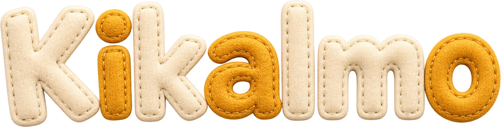

# Kikalmo



Jeu de mots et de culture générale multijoueur : retrouvez les voyelles manquantes avant les autres.

**[Jouer à Kikalmo](https://kikalmo.emmanuel-galland117.chatgpt.site)**

## Amis et navigation commune

Le menu burger est disponible sur PC et mobile, dans le jeu, la boutique et les statistiques. Les salons y sont triés par fréquentation. Le salon le plus actif est signalé dans le lobby ; les cartes et le menu affichent les avatars des amis présents.

Le panneau d’amis fournit un code public aléatoire lié au navigateur. Les demandes doivent être acceptées avant de partager la présence ou le salon. Retrait, annulation, refus, blocage et visibilité de présence sont disponibles. Les identifiants de session restent côté serveur ; le code ami n’est pas un moyen de connexion. La position est vérifiée côté serveur au clic sur Rejoindre et expire après 12 secondes sans présence de jeu. Le bouton rejoint le salon via le parcours habituel, avec son contrôle de capacité et la conservation du score lors d’un retour dans le même salon.

La liste d’amis est fonctionnelle et indépendante du consentement statistique. L’export et l’effacement des données incluent le profil ami et les relations. Migration : `0008_acoustic_professor_monster.sql`.

## Catalogue et accessoires de base

La boutique affiche tous les articles disponibles par défaut, avec les deux monnaies cochées. Les cases de monnaie sont indépendantes et se combinent avec les rayons ; un état vide explique de recocher une monnaie si les deux sont désactivées. Prix, disponibilité du bouton d’achat et navigation entre articles utilisent la monnaie propre à chaque article. Halloween conserve sa vitrine et son filtre dédié.

Les accessoires de base sont rendus à échelle uniforme : lunettes, lunettes de soleil, fleur, moustache et foulard conservent leurs proportions. Les joues sont espacées et atténuées ; le foulard passe sous le menton, lunettes et moustache derrière le nez, et la fleur devant la coiffure. Validation sur 108 assemblages et contrôle des pixels du nez.

## Identité textile Kikalmo

Le logo cousu et les marionnettes servent de référence aux composants du site. Monnaie de salon : pièce ronde en feutre doré, bord cousu et K brodé ; monnaie quotidienne : étoile de laine violette. Les boutons, onglets, cartes, fenêtres, champs et menus partagent une texture de feutre, des coutures, un relief discret et des états cohérents. Les zones de texte et de réponse gardent des fonds sobres ; le menu mobile et les interactions existantes sont conservés.

Les identifiants serveur `room` / `daily`, les tarifs, les soldes et les gains restent identiques. Seuls les noms affichés et les représentations visuelles changent. Images produites avec l’outil ImageGen intégré, assorties au logo existant : `public/branding/textile/` ; [prompts des matières et de l’étoile](docs/textile-prompts.json), [prompt de la pièce cousue](docs/currency-coin-prompt.json) ; packaging reproductible : `node scripts/package-textile.mjs <manifest.json>`.

## Mobile et tarifs de saison

Sur mobile et tablette, le menu regroupe personnage, statistiques, son et règles. La boutique garde un raccourci visible. Sur la page boutique, le choix de rayon passe par une liste déroulante ; monnaies et actions d’achat restent faciles à toucher.

Tarifs Halloween : costumes à 18 / 24 pièces de salon ou 8 éclats ; autres articles à 2–6 pièces ou 1–3 éclats. Total de la collection quotidienne : 16 éclats, soit 16 participations ordinaires sans podium. Le costume quotidien demande 8 participations ; les podiums accélèrent cette progression. Les anciennes dépenses Halloween sont ajustées automatiquement par un crédit de la différence, une seule fois par achat, dans la monnaie d’origine.

## La petite mercerie et Halloween 2026

Bouton **Boutique** visible dans l’en-tête, page dédiée `/boutique`, ambiance mercerie avec vitrine saisonnière, articles mis en avant et navigation précédent/suivant. L’atelier conserve l’équipement du personnage ; acheter ou examiner ne l’équipe jamais automatiquement.

11 pièces Halloween : trois costumes en feutre, chapeaux de sorcière, broches citrouille, nœud chauve-souris, lucioles et deux mailles à motifs. Fermeture des achats le **10 novembre 2026 à 00 h, heure de Paris** ; les pièces déjà achetées restent utilisables. Le compte à rebours est dynamique, avec contrôle d’expiration dans l’API et la requête d’achat. Les motifs suivent le masque du visage sélectionné. [Prompts ImageGen](docs/halloween-prompts.json) · [Intégration et règles](docs/costume-assets.md).

## Collection et superpositions

Six emplacements indépendants : couvre-chef, broche/effet, costume, coiffure de collection, regard de collection et maille à motifs. Les anciens profils migrent automatiquement leur unique cosmétique vers son emplacement. Les cheveux et accessoires du visage restent sous les casques ; broches et effets passent devant les tenues. Les chapeaux sont ajustés à la largeur du visage et conservent les mèches sous leur bord. Les cartes verrouillées ouvrent le bon article dans la boutique. Un achat ne modifie jamais le personnage équipé.

## Accessoires textiles et formes de visage

Les 24 accessoires de la boutique sont rendus en feutre texturé à partir de 12 assets ImageGen. Dans les costumes, la peau respecte le contour du visage choisi, avec une doublure sombre autour. [Prompts des accessoires](docs/accessory-prompts.json) · [Détails et contrôles](docs/costume-assets.md).

## Tenues fantaisie

Huit casques et combinaisons en laine et feutre : cosmonaute, scaphandrier, dragon, robot, chevalier, axolotl, champignon et pilote. Les visages gardent leurs expressions animées. [Assets, prompts et intégration](docs/costume-assets.md).

## Progression et boutique

- 49 articles, dont 11 pièces Halloween en série éphémère. **Boutique** sert aux achats et aux aperçus ; **Mon personnage** sert à équiper la collection. Les éléments de base restent gratuits.
- Premier à répondre correctement dans une manche : 1 pièce de salon. Accessoires à partir de 2 pièces ; costumes de 80 à 250 pièces de salon ou de 40 à 120 éclats. Les achats antérieurs restent acquis sans supplément.
- Monnaie quotidienne indépendante : 5 / 3 / 2 éclats au podium final ; 1 éclat aux autres participants ayant envoyé au moins une proposition, même sans résoudre le défi. Une simple ouverture ne rapporte rien.
- Classement quotidien : moins d’essais, puis heure de résolution, puis identifiant stable en cas d’égalité. Les gains sont calculés sur les journées closes, à la requête suivante après minuit à Paris, et chaque gain n’est crédité qu’une fois.
- Banque dédiée de 100 expressions/proverbes, dont 52 nouvelles formulations longues, indices après 3 et 6 erreurs et une voyelle après 9. Les 100 derniers défis sont évités avant reprise du plus ancien ; un défi déjà publié reste identique.
- Pièces et achats conservés dans D1 et liés au cookie du navigateur, séparés des statistiques facultatives. Export et effacement depuis le panneau de confidentialité. Les deux monnaies ne sont pas convertibles ; les cosmétiques ne modifient pas les scores.
- Achats atomiques au tarif serveur ; contrôle de propriété côté serveur avant affichage en salon et au classement. Les crédits de manche font partie du même batch que la mise à jour du salon et sont protégés contre les nouvelles tentatives simultanées.

Validation : `node --test tests/*.test.mjs` et `node node_modules/typescript/bin/tsc --noEmit`. Migration ajoutée : `0007_boring_jack_murdock.sql` (table de progression uniquement ; les anciennes migrations restent inchangées).


## Le jeu

- 12 salons thématiques et un salon général, avec 4 382 réponses.
- 10 manches de 20 secondes ; un indice apparaît à 10 secondes restantes.
- Lancement après un compte à rebours de 10 secondes dans un salon vide.
- Classement en direct, premier à trouver en doré et autres bonnes réponses en vert.
- Avatars en feutre personnalisables : morphologie, coiffure, yeux, nez, bouche, vêtements, accessoires et couleur.
- Expressions animées, émotes personnalisées et sons.
- Chat : Entrée pour envoyer, flèche ↑ dans le champ vide pour rappeler son dernier message.
- Interface adaptée au mobile et respect du mouvement réduit.

## Développement

Node.js **22.13 ou plus récent** est requis.

```sh
corepack enable
pnpm install --frozen-lockfile
pnpm dev
```

Le profil local par défaut est portable. Le multijoueur utilise le serveur et une base Cloudflare D1 ; la version publiée ci-dessus constitue le déploiement de référence.

```sh
node --test tests/*.test.mjs
pnpm exec tsc --noEmit --incremental false
pnpm build
```

## Organisation

| Dossier | Contenu |
| --- | --- |
| `app/` | Interface React et API du jeu |
| `lib/` | Règles, profils, questions, indices et assemblage des avatars |
| `public/` | Sprites, sons, logo et favicon |
| `data/` | Sources graphiques et documentation des assets |
| `tests/` | Vérifications du jeu, de l’API, des profils et des avatars |
| `scripts/` | Construction, préparation des sprites et rendus de contrôle |

Stack : TypeScript, React, Vinext/Vite, Cloudflare Workers et D1. Détails du runtime : [documentation Sites](docs/sites-runtime.md). Assemblage des personnages : [PUPPET_ASSETS.md](data/PUPPET_ASSETS.md).

## Historique importé

Les **28 étapes du dépôt source Sites**, jusqu’au commit `9a20512`, sont reprises dans l’historique GitHub. Les fichiers et arbres Git de chaque étape conservent leurs empreintes d’origine.

L’import via l’API GitHub recrée les commits avec de nouveaux identifiants et de nouvelles métadonnées de création. Les références originales, auteurs et dates sont conservés dans [SOURCE_HISTORY.json](SOURCE_HISTORY.json) et dans les messages des commits importés. Les commits de documentation ajoutés après l’import sont propres à ce dépôt GitHub.

Les données de jeu en production et les secrets d’exécution ne sont pas inclus.

### Pièces et prix

Une partie terminée avec une proposition dans au moins cinq manches rapporte trois pièces. En multijoueur, trouver en premier rapporte une pièce supplémentaire par manche. En solo, chaque groupe de trois mots trouvés rapporte une pièce, dans la limite de trois par partie. Les crédits sont atomiques avec la sauvegarde du salon et uniques par partie, joueur et seuil ; les reconnexions ne remettent pas la progression à zéro. Les étoiles restent inchangées.

Accessoires : 8–40 pièces ; coiffures et regards : 45–75 ; costumes Halloween : 60–80 ; costumes permanents : 180–550. Les achats acquis restent équipables et aucun solde existant n’est débité par la hausse des prix. Le remboursement historique Halloween conserve ses anciens montants.

### Discussion du salon et messagerie privée

La discussion du salon reste dans le fil du jeu : pendant la recherche, seuls les joueurs qui ont trouvé peuvent échanger, puis les messages deviennent visibles à tous à la révélation.

L’onglet Messages en bas de l’écran ouvre des conversations privées entre amis acceptés, dans le jeu, à l’accueil et dans la boutique. Les messages persistent 90 jours ; historique paginé, non-lus et accusés de lecture utilisent une API séparée. Un identifiant d’envoi unique évite les doublons lors des réessais. Les appels de messagerie vérifient l’amitié et le blocage côté serveur ; les écritures revérifient ces conditions atomiquement.

Le bouton Ajouter est masqué pour les personnes déjà amies ou bloquées. Les options d’un joueur permettent d’ouvrir un message privé ou de bloquer. Le panneau de messagerie et Mes amis donnent accès à la liste des personnes bloquées et au déblocage. Débloquer ne rétablit pas l’amitié. L’export et l’effacement couvrent aussi les échanges privés.

### Documentation du projet

[Dossier, cahier des charges et mode opératoire](docs/projet/README.md), avec un PDF de 24 pages dans la direction artistique textile du site et des sources éditables.

## Réserve de questions et rotation

Les douze thèmes contiennent chacun 1 000 réponses ; le généraliste rassemble les 12 000 entrées. Les 6 000 réponses déjà publiées conservent leurs indices et leur contenu. Les salons excluent les 100 dernières questions lors d’un nouveau tirage, avec une mémoire conservée après le retour à vide. La réserve du mot du jour reste indépendante. Sources, crédits et reconstruction : [data/BANK_SOURCES.md](data/BANK_SOURCES.md).
